# Database

The Cosmic Explorer DCC stores all metadata in a single MariaDB database,
`dcc_docdb`. The document files themselves are *not* in the database; they are
plain files on disk under a directory whose name is derived from the
`Document.Alias` column (see [Document storage layout](architecture.md#document-storage-layout)).

This page describes the schema as it exists in production (51 tables), the
meaning the Perl code gives to each column, the Cosmic Explorer-specific seed
data, and how to back the database up. The authoritative source for columns,
types and indexes is the running database; the DDL quoted here was extracted
from it. The authoritative source for *meaning* is the Perl code in
`usr1/www/cgi-bin/private/DocDB/`, chiefly the `*SQL.pm` modules and
`Security.pm`; file references below are relative to that directory.

Related pages: [architecture](architecture.md),
[authentication and authorization](authentication-and-authorization.md),
[code layout](code-layout.md).

## 1. Overview

| Item | Value |
|------|-------|
| Engine | MariaDB 10.4.8 (`mariadb:10.4.8` image, service `dcc_docdb-database` in the `dcc` swarm stack, hostname `docdb-database` on the `dcc-net` overlay network) |
| Database | `dcc_docdb` (`CREATE DATABASE ... DEFAULT CHARACTER SET latin1`) |
| Storage engine | Every table is `ENGINE=MyISAM` |
| Character set | Every table is `DEFAULT CHARSET=latin1` (so the default collation is `latin1_swedish_ci`, which makes `=` and `LIKE` comparisons case-insensitive) |
| Foreign keys | None declared. MyISAM does not enforce them anyway. All relationships are conventions in the Perl code, described below |
| Transactions | None. MyISAM is non-transactional; the code never uses `BEGIN`/`COMMIT` and every write is auto-committed |
| Data on the host | `/srv/docker/dcc/var/lib/mysql` (`${STORAGE_PATH}/var/lib/mysql` in `ce-it-infrastructure/dcc/dcc.yml`), bind-mounted to `/var/lib/mysql` in the `docdb-database` container. The same directory is also bind-mounted into the `dcc` web container, where only the marker file `docdb.init` is used (see section 4) |
| Connection from Perl | `DBI->connect('DBI:mysql:dcc_docdb:docdb-database', $user, $pass)` with `$db_name`/`$db_host` from `SiteConfig.pm` |

### Accounts

Three MariaDB accounts matter. Their grants are set once by the bootstrap
script `ce-it-infrastructure/dcc/docdb.sh`; their passwords live in Docker
Swarm secrets and are substituted into the two `SiteConfig.pm` files by
`usr/local/sbin/start-apache.sh` when the web container starts (the copies in
this repository and in the image hold the placeholder `Change.Me.too!`).

| Account | Grants | Used by | Secret |
|---------|--------|---------|--------|
| `docdbrw`@`%` / `localhost` | `SELECT, INSERT, UPDATE, DELETE ON dcc_docdb.*` | The private, authenticated instance (`/cgi-bin/private/DocDB/`, `$db_rwuser` in `private/DocDB/SiteConfig.pm`) and the `rest-api` service (`rest-dcc/database.js`) | `mysql_docdbrw_passwd` |
| `docdbro`@`%` / `localhost` | `SELECT ON dcc_docdb.*` | The public instance (`/cgi-bin/DocDB/`); its `SiteConfig.pm` sets `$Public = 1` and blanks `$db_rwuser`/`$db_rwpass`, so it can only ever read | `mysql_docdbro_passwd` |
| `root`@`localhost` / `127.0.0.1` | everything | `docdb.sh` bootstrap, manual dumps and schema changes | `mariadb_root_password` (used by the `mariadb` image via `MYSQL_ROOT_PASSWORD_FILE`) and `mysql_root_passwd` (used by `docdb.sh`) |

`docdb.sh` also resets passwords for two legacy accounts, `wikiuser` and
`wikidb_restore`, inherited from the LIGO VM image; nothing in this repository
uses them.

Note that `docdbro` lacks `LOCK TABLES`, which matters for consistent dumps
(section 5).

## 2. Entity-relationship overview

```mermaid
erDiagram
    Document {
        int DocumentID PK
        int RequesterID "Author.AuthorID"
        datetime RequestDate
        char DocHash
        varchar Alias "e.g. T2500004, on-disk dir"
    }
    DocumentRevision {
        int DocRevID PK
        int DocumentID
        int SubmitterID "Author.AuthorID"
        int VersionNumber
        int DocTypeID
        tinyint Obsolete
        tinyint QAcheck
        varchar Keywords "free text"
    }
    DocumentFile {
        int DocFileID PK
        int DocRevID
        varchar FileName
        tinyint RootFile
    }
    Author {
        int AuthorID PK
        varchar FirstName
        varchar LastName
        int InstitutionID
        int Active
    }
    EmailUser {
        int EmailUserID PK
        char Username
        char EmailAddress
        int AuthorID
        int CanSign
        int Verified
    }
    RemoteUser {
        int RemoteUserID PK
        char RemoteUserName "lower-cased ePPN"
        int EmailUserID
    }
    SecurityGroup {
        int GroupID PK
        char Name
        int CanCreate
        int CanAdminister
        int CanView
        int CanConfig
        enum DisplayInList
    }

    Document ||--o{ DocumentRevision : "versions"
    DocumentRevision ||--o{ DocumentFile : "files"
    DocumentType ||--o{ DocumentRevision : "DocTypeID"
    Author ||--o{ Document : "RequesterID"
    Author ||--o{ DocumentRevision : "SubmitterID"
    DocumentRevision ||--o{ RevisionAuthor : "authors"
    Author ||--o{ RevisionAuthor : "AuthorID"
    Institution ||--o{ Author : "InstitutionID"
    AuthorGroupDefinition ||--o{ AuthorGroupList : "members"
    Author ||--o{ AuthorGroupList : "AuthorID"
    AuthorGroupDefinition ||--o{ RevisionAuthorGroup : "collective author"
    DocumentRevision ||--o{ RevisionAuthorGroup : "author groups"
    Author |o--o| EmailUser : "EmailUser.AuthorID"
    EmailUser ||--o{ RemoteUser : "logins"
    EmailUser ||--o{ UsersGroup : "memberships"
    SecurityGroup ||--o{ UsersGroup : "GroupID"
    SecurityGroup ||--o{ GroupHierarchy : "ParentID"
    SecurityGroup ||--o{ GroupHierarchy : "ChildID"
    DocumentRevision ||--o{ RevisionSecurity : "view groups"
    SecurityGroup ||--o{ RevisionSecurity : "GroupID"
    DocumentRevision ||--o{ RevisionModify : "modify groups"
    SecurityGroup ||--o{ RevisionModify : "GroupID"
    Topic ||--o{ TopicHierarchy : "TopicID / ParentTopicID"
    DocumentRevision ||--o{ RevisionTopic : "topics"
    Topic ||--o{ RevisionTopic : "TopicID"
    KeywordGroup ||--o{ KeywordGrouping : "groups"
    Keyword ||--o{ KeywordGrouping : "KeywordID"
    Journal ||--o{ RevisionReference : "JournalID"
    DocumentRevision ||--o{ RevisionReference : "references"
    DocumentRevision ||--o{ DocXRef : "refers to"
    Document ||--o{ DocXRef : "target DocumentID"
    EventGroup ||--o{ Conference : "EventGroupID"
    Conference ||--o{ Session : "ConferenceID"
    Session ||--o{ SessionTalk : "SessionID"
    Document ||--o{ SessionTalk : "DocumentID"
    Session ||--o{ MeetingOrder : "SessionID"
    SessionTalk ||--o{ SessionOrder : "SessionTalkID"
    DocumentRevision ||--o{ RevisionEvent : "DocRevID"
    Conference ||--o{ RevisionEvent : "ConferenceID"
    DocumentRevision ||--o{ Signoff : "DocRevID"
    Signoff ||--o{ Signature : "SignoffID"
    EmailUser ||--o{ Signature : "signer"
    Signoff ||--o{ SignoffDependency : "PreSignoffID"
    EmailUser ||--o{ Notification : "subscriptions"
```



### How the pieces fit together

**Documents are version trees.** A `Document` row is little more than an
identity: a numeric `DocumentID`, a human-facing `Alias` such as `T2500004`,
the `RequesterID` of the person who first reserved it and a `DocHash` used to
reject accidental double submissions. Everything a user would call "the
document" (title, abstract, type, authors, topics, files, access lists) hangs
off a `DocumentRevision` row, one per version. Almost every other table is a
join table keyed by `DocRevID`: `RevisionAuthor`, `RevisionAuthorGroup`,
`RevisionTopic`, `RevisionSecurity`, `RevisionModify`, `RevisionEvent`,
`RevisionReference`, `DocXRef`, `DocumentFile`, `Signoff`. When a revision is
re-saved with "Update DB info" the old row for that `(DocumentID,
VersionNumber)` is marked `Obsolete=1` and a fresh row (with a fresh
`DocRevID` and fresh join rows) is inserted, so the join tables keep history
that the UI never shows.

**Two kinds of people.** `Author` is the bibliographic identity (name,
institution) that appears on author lists; `EmailUser` is the login/account
identity (username, e-mail, permissions). They are linked one-to-one by
`EmailUser.AuthorID`. `Document.RequesterID` and
`DocumentRevision.SubmitterID` hold **Author** IDs, not EmailUser IDs:
`Security.pm::CanAccess` converts the logged-in `EmailUserID` to an
`AuthorID` with `FetchAuthorIDFromEmailUserID` before comparing it to
`Submitter` and `Requester`, and `FSUtilities.pm::ProtectDirectory` calls
`FetchEmailUserIDFromAuthorID($Requester)`. (`CanModify` compares
`SubmitterID == $EmailUserID` directly, which only works because, in this
installation, provisioned users receive the same numeric ID (their COmanage `DccDocDbID` identifier) in
`Author`, `EmailUser` and `RemoteUser`; see section 4.)

**Login mapping.** Apache/Shibboleth put the user's
`eduPersonPrincipalName` into `REMOTE_USER`; `DocDBGlobals.pm` lower-cases it
and `SecuritySQL.pm::FetchEmailUserIDFromRemoteUser` looks it up in
`RemoteUser.RemoteUserName` to get an `EmailUserID`. Group membership is
`UsersGroup` (EmailUser to SecurityGroup).

**Access control is per revision, by group.** `RevisionSecurity` lists the
`SecurityGroup`s that may *view* a revision; `RevisionModify` lists those that
may *modify* it (`$EnhancedSecurity = 1` in `ProjectGlobals.pm`). A revision
with **no** `RevisionSecurity` rows is public. `GroupHierarchy` lets a parent
group see everything a child group can see. Admin groups
(`SecurityGroup.CanAdminister = 1`) bypass the per-revision lists. Full
details are in [authentication and authorization](authentication-and-authorization.md).

**Classification** is by `DocumentType` (one per revision; it also determines
the alias prefix and the per-type counter), `Topic` (many per revision, with a
parent/child hierarchy), free-text `Keywords`, journal `RevisionReference`s
and `DocXRef` cross-references to other documents.

**Events** (`Conference`) belong to an `EventGroup` and contain `Session`s,
which contain `SessionTalk`s that may point at a `Document`. Ordering is kept
in `MeetingOrder` (sessions and separators within an event) and
`SessionOrder` (talks and separators within a session).

**Sign-offs** are chains of `Signoff` rows per revision linked by
`SignoffDependency`, each with `Signature` rows for the `EmailUser`s who must
sign. `DocumentReview` is a separate, LIGO-specific publication review state.

## 3. Table reference

Conventions used in the tables below:

* Every table has an `int(11) AUTO_INCREMENT` primary key named after the
  table, and most have a `TimeStamp timestamp NOT NULL DEFAULT
  current_timestamp() ON UPDATE current_timestamp()` column, which is the
  last-modified time of the row (it moves on every `UPDATE`). These two are
  only listed where something about them is noteworthy.
* "FK to X.Y" means the code treats the column as a reference to `X.Y`; no
  constraint exists in the database.
* Row counts are approximate, from the April 2026 dump (section 5), and are
  given only to indicate which tables are actually used.

### 3.1 Documents and revisions

#### `Document`

One row per document, created by `DocumentSQL.pm::InsertDocument` when a
document is reserved or added. Carries only identity; everything else is on
`DocumentRevision`. ~930 rows.

| Column | Type | Meaning |
|--------|------|---------|
| `DocumentID` | int(11) PK | Numeric document number (the `1234` in `1234-v2`). |
| `RequesterID` | int(11) NOT NULL DEFAULT 0 | FK to `Author.AuthorID`: the author record of the person who created/reserved the document. `CanAccess` grants the requester access to every version; a value of 0 makes the document inaccessible to non-public code paths. Indexed (`Requester`). |
| `RequestDate` | datetime | When the document was created. |
| `DocHash` | char(32) | Hash of the submission form, set from the add form's unique key. `ProcessDocumentAdd` refuses a submission whose `DocHash` already exists ("duplicate of document N"). |
| `Alias` | varchar(255) | The document's public identifier and **on-disk directory name**. Generated by `InsertDocument` as `sprintf("%s%02d%05d", <first word character of DocumentType.ShortType>, <two-digit year>, DocumentType.NextDocNumber)`, e.g. `T2500004` for the 4th Technical note of 2025, unless an explicit `-docnumber` is passed. With `$UseAliasAsFileName = 1` (`ProjectGlobals.pm`), `FSUtilities.pm::GetDirectory` builds `$file_root/<DocumentID div 1000, 4 digits>/<Alias>/<version, 3 digits>/`, e.g. `/usr1/www/html/DocDB/0000/T2500004/001/`. `GetDocumentIDByAlias` resolves aliases typed into cross-reference fields (regex `(LIGO-)?([A-Z]\d{5,8})(-[vx](\d+))?`). Indexed. |

#### `DocumentRevision`

One row per version of a document, plus obsolete rows left behind by
re-saves. Written by `RevisionSQL.pm::InsertRevision`; read everywhere through
`FetchDocRevisionByID`, which always adds `and Obsolete=0`. ~3,400 rows.

| Column | Type | Meaning |
|--------|------|---------|
| `DocRevID` | int(11) PK | Revision identity; the key used by all `Revision*` join tables. |
| `DocumentID` | int(11) NOT NULL DEFAULT 0 | FK to `Document.DocumentID`. Indexed. |
| `SubmitterID` | int(11) NOT NULL DEFAULT 0 | FK to `Author.AuthorID`: who submitted this version. `CanAccess` grants the submitter access; a value of 0 makes the revision inaccessible. |
| `DocumentTitle` | varchar(255) NOT NULL | Title. Indexed. |
| `PublicationInfo` | text | Free-text publication information. |
| `VersionNumber` | int(11) NOT NULL DEFAULT 0 | Version. `0` is a reserved document with no content yet (`InsertRevision(-version => "reserve")`). `"bump"` inserts `max+1`; `"latest"` re-inserts the current version. Indexed. |
| `Abstract` | text | Abstract. |
| `RevisionDate` | datetime | Date the version was made; `UpdateRevision` sets it to now. |
| `Obsolete` | tinyint(4) DEFAULT 0 | `1` marks a superseded row for the same `(DocumentID, VersionNumber)`. `InsertRevision` sets `Obsolete=1` on the existing row unless the mode is `bump` or `reserve`. All fetches filter `Obsolete=0`. |
| `Keywords` | varchar(400) | Free-text, space-separated keywords (not FKs to `Keyword`). Matched as `TextKey` for `Notification.Type='Keyword'`. |
| `Note` | text | Revision note shown to users. |
| `Demanaged` | int(11) | When non-zero, `SignoffUtilities.pm::RevisionStatus` reports the sign-off status as "Demanaged" (document removed from change control). Nothing in this code base writes it. |
| `DocTypeID` | int(11) | FK to `DocumentType.DocTypeID`. The document type lives on the revision, not on `Document`. |
| `QAcheck` | tinyint(4) DEFAULT 0 | "flag when QA verifies rev". The public-release flag: see *Public_Pending flow* below. Written by `UpdateRevisionQAState` (`XMLClone`) and directly by `ProcessDocumentAdd` ("Preserve the old qastat if only minor changes were made"). |
| `Migrated` | int(11) DEFAULT 0 | Comment says `0=not_migrated 1=created 2=updated`. **Not referenced by any Perl code**; legacy from the LIGO migration. |

**Public_Pending flow.** `ProjectGlobals.pm` sets `$Public_QAcheck = 1`,
`$PublicPending_QA = 0`, `$Public_Group = "Public_Pending"` and
`$Certify_Group = "Public_Certify"`. `SecuritySQL.pm::UpdateRevisionPublicSecurity($DocumentID, $Version, $QAcheck)`
implements the state machine:

* `QAcheck == 0` (not yet certified) and the revision has **no**
  `RevisionSecurity` rows: insert a row for the `Public_Pending` group
  (GroupID 1) and `UnlinkDirectory` the public symlink. The revision is thus
  not public yet; only members/ancestors of `Public_Pending` see it.
* `QAcheck != 0` and one of the view groups is `Public_Pending`: delete **all**
  `RevisionSecurity` rows for the revision (making it public) and
  `MakeLinkDirectory` a symlink from the public file tree to the private one.

`ProcessDocumentAdd` calls this with `0` for new content (`add`, `update`,
`use`, `reserve`) and with the preserved `QAcheck` on `updatedb` when the
"reset state" box is not ticked. `CanCertify` (who may flip the flag) looks
for a group named `Public_Certify`; no such group exists in the production
data, so in practice only administrators appear to be able to certify (the
`Security.pm` logic falls through to `CanAdminister` elsewhere). The
`Uncertified` keyword in `Keyword` is a related manual convention.

### 3.2 Files

#### `DocumentFile`

One row per uploaded file of a revision. Written by
`FileSQL.pm::InsertFile`, read by `MiscSQL.pm::FetchDocFiles`. ~3,400 rows.

| Column | Type | Meaning |
|--------|------|---------|
| `DocFileID` | int(11) PK | |
| `DocRevID` | int(11) NOT NULL DEFAULT 0 | FK to `DocumentRevision.DocRevID`. Indexed. |
| `FileName` | varchar(255) NOT NULL | Base name of the file in the revision directory (`GetDirectory`, see `Document.Alias`). |
| `Date` | datetime | Upload time. |
| `RootFile` | tinyint(4) DEFAULT 1 | `1` = a "main" file shown prominently; `0` = supporting/other file (the `-main` parameter of `InsertFile`). |
| `Description` | varchar(128) | User description. **Soft-delete convention:** every read (`FetchDocFiles`, `FetchFile`, `ExistsFile`) excludes rows whose `Description` contains `delete`, `remove` or `ignore`, so such files vanish from the UI without a `DELETE`. |

There is no table for file content, checksums or sizes; `FSUtilities.pm`
stats the file on disk.

### 3.3 People and authorship

#### `Author`

Bibliographic identities used in author lists, moderators and talk hints.
Written by `AuthorAdd`/`AuthorAdminister` and by the REST API (section 4).
~720 rows. `AUTO_INCREMENT` is 1,000,728, the same as `EmailUser` and
`RemoteUser`, which is a strong hint that the provisioner inserts the three
rows for a person with one shared ID.

| Column | Type | Meaning |
|--------|------|---------|
| `AuthorID` | int(11) PK | |
| `FirstName` | varchar(100) NOT NULL | |
| `MiddleInitials` | varchar(16) | Matched exactly (dots stripped) by `ProcessManualAuthors`; this matching is a Cosmic Explorer patch (`ce-it-infrastructure/dcc/AuthorSQL.pm.patch`). |
| `LastName` | varchar(100) NOT NULL | Indexed (`Name`). |
| `InstitutionID` | int(11) NOT NULL DEFAULT 0 | FK to `Institution.InstitutionID`. |
| `Active` | int(11) DEFAULT 1 | `0` = inactive. Besides hiding the author from pick lists, `CanAccess` **returns 0 for any non-public request by a user whose own Author row has `Active = 0`**, so deactivating an author also locks out that person's login. |
| `AuthorAbbr` | varchar(10) | Comment "Used in the Old DCC". Not referenced by any Perl code. |
| `FullAuthorName` | varchar(256) | Comment "Used in the Old DCC". Not referenced by any Perl code. |

#### `Institution`

Lookup table for author affiliations. ~24 rows (see section 4).

| Column | Type | Meaning |
|--------|------|---------|
| `InstitutionID` | int(11) PK | |
| `ShortName` | varchar(40) NOT NULL | e.g. `SU` |
| `LongName` | varchar(80) NOT NULL | e.g. `Syracuse University` |

#### `AuthorGroupDefinition`, `AuthorGroupList`, `RevisionAuthorGroup`

"Author groups" let a collective (e.g. *Cosmic Explorer Project*) be named as
the author of a revision. `AuthorGroupDefinition` defines the group,
`AuthorGroupList` lists its member authors, and `RevisionAuthorGroup` attaches
a group to a revision. `AuthorSQL.pm::GetAllRevisionAuthors` expands groups
into individual authors, and `SecuritySQL.pm::isEmailUserAnAuthor` treats
members of an attached group as authors for the `Authors` security group.
These three tables have no `TimeStamp` column. In production
`AuthorGroupDefinition` has 2 rows, `RevisionAuthorGroup` ~310 and
`AuthorGroupList` **none**, so group membership expansion currently yields
nothing.

| Table.Column | Type | Meaning |
|--------------|------|---------|
| `AuthorGroupDefinition.AuthorGroupID` | int(11) PK | |
| `AuthorGroupDefinition.AuthorGroupName` | varchar(32) NOT NULL | Short name; with `$AuthorsOnly_GroupSuffix` (`_Authors`) appended it is also used as an htdbm group name in `ProtectDirectory`. |
| `AuthorGroupDefinition.Description` | varchar(64) | |
| `AuthorGroupList.AuthorGroupListID` | int(11) PK | |
| `AuthorGroupList.AuthorGroupID` | int(11) NOT NULL | FK to `AuthorGroupDefinition`. |
| `AuthorGroupList.AuthorID` | int(11) NOT NULL | FK to `Author`. |
| `RevisionAuthorGroup.RevAuthorGroupID` | int(11) PK | |
| `RevisionAuthorGroup.AuthorGroupID` | int(11) NOT NULL | FK to `AuthorGroupDefinition`. |
| `RevisionAuthorGroup.DocRevID` | int(11) NOT NULL | FK to `DocumentRevision`. No index. |

#### `RevisionAuthor`

Ordered author list of a revision. Written by `AuthorSQL.pm::InsertAuthors`.
~8,900 rows.

| Column | Type | Meaning |
|--------|------|---------|
| `RevAuthorID` | int(11) PK | |
| `DocRevID` | int(11) NOT NULL DEFAULT 0 | FK to `DocumentRevision`. Indexed. |
| `AuthorID` | int(11) NOT NULL DEFAULT 0 | FK to `Author`. Indexed. |
| `AuthorOrder` | int(11) DEFAULT 0 | Position in the author list when the submitter asked to preserve order; otherwise 0 for all rows. |

#### `EmailUser`

Login/account identity: who can log in, their e-mail, and per-user
permissions. Originally the record for DocDB's own password logins and e-mail
notifications; in this installation rows are created by the REST API
(section 4) and, for the certificate/password flows that still exist in the
code (`UserAccessApply`, `EmailCreate`, `SelectEmailPrefs`,
`BulkCertificateInsert`), by the application. ~720 rows.

| Column | Type | Meaning |
|--------|------|---------|
| `EmailUserID` | int(11) PK | The ID used by `UsersGroup`, `RemoteUser`, `Signature`, `Notification`. |
| `Username` | char(255) NOT NULL | Login name. Used for password logins (`EmailSecurity.pm::ValidateEmailUser`) and written into per-directory access lists by `ProtectDirectory`. |
| `Password` | char(32) NOT NULL DEFAULT '' | Hashed password for DocDB's native login. Unused for Shibboleth logins; the certificate paths insert the literal `'x'`. |
| `Name` | char(255) NOT NULL | Display name. `SignoffSQL.pm::ProcessSignoffList` matches typed signer names against it exactly. |
| `EmailAddress` | char(255) NOT NULL | Notification address. `FetchEmailUserIDFromEmailAddress` matches with `LIKE`. |
| `PreferHTML` | int(11) NOT NULL DEFAULT 0 | Notification e-mail format preference. |
| `CanSign` | int(11) NOT NULL DEFAULT 0 | May be a signatory on sign-offs (`EmailSecurity.pm::CanSign`). |
| `Verified` | int(11) NOT NULL DEFAULT 0 | Account approved by an administrator (certificate workflow). Values other than 1 are treated as 0. |
| `AuthorID` | int(11) NOT NULL DEFAULT 0 | FK to `Author.AuthorID`; the link between the login identity and the bibliographic identity. 0 = no author record. |
| `EmployeeNumber` | int(11) NOT NULL DEFAULT 0 | LIGO employee number. Only used to resolve `DocumentReview.EmployeeNumber` to a name (`FetchNameFromEmployeeNumber`). Legacy for Cosmic Explorer. |

#### `RemoteUser`

Maps an external login name to an `EmailUser`. In this installation the login
name is the Shibboleth `eduPersonPrincipalName` (`shibboleth2.xml` sets
`REMOTE_USER="eduPersonPrincipalName eppn ..."`), lower-cased by
`DocDBGlobals.pm` (`use constant remote_user => &tolower($ENV{REMOTE_USER})`)
and looked up with `select EmailUserID from RemoteUser where RemoteUserName
like ("<name>")` (`SecuritySQL.pm::FetchEmailUserIDFromRemoteUser`). The
`RemoteUserHasAccess` helper used for file downloads does the same lookup.
No `TimeStamp` column. ~720 rows.

| Column | Type | Meaning |
|--------|------|---------|
| `RemoteUserID` | int(11) PK | |
| `RemoteUserName` | char(255) NOT NULL | The ePPN, e.g. `jdoe@syr.edu`. Indexed (`Name`). Compared with `LIKE`, so `%` or `_` in a value would act as wildcards. |
| `EmailUserID` | int(11) NOT NULL DEFAULT 0 | FK to `EmailUser.EmailUserID`. |
| `EmailAddress` | char(255) NOT NULL | Copy of the user's e-mail; not read by the Perl code. |

### 3.4 Access control

See [authentication and authorization](authentication-and-authorization.md)
for the algorithms; this section documents the storage.

#### `SecurityGroup`

The groups that appear in view/modify lists and carry site-wide privilege
flags. Read by `SecuritySQL.pm::GetSecurityGroups`; created through
`GroupAdminister` or the REST API. 12 rows (section 4).

| Column | Type | Meaning |
|--------|------|---------|
| `GroupID` | int(11) PK | |
| `Name` | char(32) NOT NULL | Group name. Looked up case-insensitively by `FetchSecurityGroupByName`; several names are special: `Public_Pending` (`$Public_Group`), `Authors` (`$AuthorsOnly_Group`), `Public_Certify` (`$Certify_Group`, absent in production), `Obsolete` (`$Obsolete_Group`, absent). |
| `Description` | char(64) | |
| `CanCreate` | int(11) DEFAULT 0 | Members may create documents and may be granted modify rights (`CanCreate`, `CanModify`). |
| `CanAdminister` | int(11) DEFAULT 0 | Members are administrators: `CanAdminister()` is true, and `CanAccess`/`CanModify` return 1 before consulting the per-revision lists. |
| `CanView` | int(11) DEFAULT 1 | A membership only counts for viewing (and for creating) if the group has `CanView = 1`. |
| `CanConfig` | int(11) DEFAULT 0 | Loaded into `%SecurityGroups` but no code path in this tree tests it. |
| `DisplayInList` | enum('0','1','2','3') DEFAULT '1' | `0` = don't display, `1` = display everywhere, `2` = force display in a specific list, `3` = display only in group membership. `isSecurityGroupInHierarchy` returns false when the child's value is `2`. |

#### `GroupHierarchy`

Parent/child relationships between security groups. A user in the **parent**
group can view documents whose `RevisionSecurity` names the **child**
(`CanAccess`), and with `$SuperiorsCanModify = 1` can modify documents whose
`RevisionModify` names the child. `ProtectDirectory` also adds parents of each
view group to the file-access list. The code only walks **one level**: it
looks for hierarchy rows whose `ParentID` is one of the user's groups and
compares `ChildID` to the document's groups, so transitive relationships must
be stored explicitly (and are, see section 4). 14 rows.

| Column | Type | Meaning |
|--------|------|---------|
| `HierarchyID` | int(11) PK | |
| `ChildID` | int(11) NOT NULL DEFAULT 0 | FK to `SecurityGroup.GroupID`: the subordinate group. |
| `ParentID` | int(11) NOT NULL DEFAULT 0 | FK to `SecurityGroup.GroupID`: the superior group that inherits the child's view rights. |

#### `UsersGroup`

Membership of `EmailUser`s in `SecurityGroup`s. Read by
`FetchUserGroupIDs(EmailUserID)` and `FetchEmailUserIDsBySecurityGroup`.

| Column | Type | Meaning |
|--------|------|---------|
| `UsersGroupID` | int(11) PK | |
| `EmailUserID` | int(11) | FK to `EmailUser`. Indexed. |
| `GroupID` | int(11) | FK to `SecurityGroup`. **No index** and no uniqueness constraint on `(EmailUserID, GroupID)`. |

The April 2026 dump holds roughly **187,000** rows for ~720 users, with many
exact duplicates sharing one timestamp. This appears to be the COmanage
provisioner re-inserting memberships on every sync rather than checking for
existing rows. The code tolerates duplicates (it only tests membership), but
the table could be de-duplicated and a unique key added if growth becomes a
problem.

#### `RevisionSecurity`

The **view** access list of a revision: one row per group that may see it. A
revision with no rows is public. Written by `SecuritySQL.pm::InsertSecurity`
(`-viewids`) and by `UpdateRevisionPublicSecurity`. ~3,800 rows.

| Column | Type | Meaning |
|--------|------|---------|
| `RevSecurityID` | int(11) PK | |
| `GroupID` | int(11) NOT NULL DEFAULT 0 | FK to `SecurityGroup`. Indexed (`Grp`). GroupID 1 = `Public_Pending` has the special meaning described under `DocumentRevision.QAcheck`. |
| `DocRevID` | int(11) NOT NULL DEFAULT 0 | FK to `DocumentRevision`. Indexed (`Revision`). |

#### `RevisionModify`

The **modify** access list of a revision. Only written when
`$EnhancedSecurity` is true (it is). If a revision has view groups but no
modify rows, `CanModify` falls back to "anyone who can view may modify". The
group named `Authors` here means "the revision's authors may modify".
~4,100 rows.

| Column | Type | Meaning |
|--------|------|---------|
| `RevModifyID` | int(11) PK | |
| `GroupID` | int(11) | FK to `SecurityGroup`. Indexed. |
| `DocRevID` | int(11) | FK to `DocumentRevision`. Indexed. |

#### `DocumentTypeSecurity`

Restricts which `DocumentType`s a user may pick in the add/update form
(`RevisionHTML.pm`, around line 109). If **any** row exists for a
`DocTypeID`, the type is offered only to users who belong to a `GroupID`
listed for it with `IncludeType = 1`; types with no rows are offered to
everyone. No `TimeStamp`. 10 rows, all for types 13, 14 and 15 and all
naming `GroupID`s (9-17, 51, 53) that do **not** exist in `SecurityGroup`,
so in production the types *X - Safety Incident Reports*, *R - Operations
Change Requests* and *A - Acquisitions* appear to be hidden from every user.
These rows are LIGO leftovers.

| Column | Type | Meaning |
|--------|------|---------|
| `DocTypeSecID` | int(11) PK | |
| `DocTypeID` | int(11) NOT NULL | FK to `DocumentType`. |
| `GroupID` | int(11) NOT NULL | FK to `SecurityGroup`. |
| `IncludeType` | int(11) DEFAULT 1 | `0 = exclude, 1 = include`; only `1` is acted on. |

#### `MeetingSecurity`, `MeetingModify`

View and modify group lists for events (`Conference`), analogous to
`RevisionSecurity`/`RevisionModify`. Rewritten wholesale (delete then insert)
by `MeetingSecuritySQL.pm::MeetingSecurityUpdate` whenever an event is saved.
~65 rows each.

| Table.Column | Type | Meaning |
|--------------|------|---------|
| `MeetingSecurity.MeetingSecurityID` / `MeetingModify.MeetingModifyID` | int(11) PK | |
| `ConferenceID` | int(11) | FK to `Conference`. Indexed. |
| `GroupID` | int(11) | FK to `SecurityGroup`. |

### 3.5 Classification: types, topics, keywords, journals, cross-references

#### `DocumentType`

Document categories. The first word character of `ShortType` becomes the
alias prefix. 16 rows (section 4).

| Column | Type | Meaning |
|--------|------|---------|
| `DocTypeID` | int(11) PK | |
| `ShortType` | varchar(32) | e.g. `T - Technical notes`. `InsertDocument` takes the first `\w` character (`T`) as the alias prefix. |
| `LongType` | varchar(255) | Description. |
| `TimeStamp` | timestamp ON UPDATE | Last change to the row. **Load-bearing:** `MiscSQL.pm::FetchNextDocNumber` compares the year of `TimeStamp` with the current year and, if they differ, resets `NextDocNumber` to 1 before use. Because every `UPDATE` (including the counter increment) refreshes `TimeStamp`, the counter restarts in the first allocation of each calendar year. Editing a type's description before the first allocation of a new year also refreshes the timestamp and suppresses that year's reset. |
| `NextDocNumber` | int(11) | Per-type counter used for the numeric part of `Document.Alias`; incremented by `UpdateNextDocNumber` after each insert. Not transactional: two simultaneous submissions of the same type could get the same alias. |

#### `Topic`, `TopicHierarchy`, `RevisionTopic`

A topic tree and the many-to-many link to revisions. `TopicSQL.pm::GetTopics`
loads both tables and `TopicUtilities.pm::BuildTopicProvenance` computes
ancestors; `DeleteTopic` cascades to `RevisionTopic`, `TopicHint`,
`EventTopic`, `TopicHierarchy`, `Notification` (Type `Topic`) and
`ConfigSetting`. 92 topics, 86 hierarchy rows, ~6,000 revision links.

| Table.Column | Type | Meaning |
|--------------|------|---------|
| `Topic.TopicID` | int(11) PK | |
| `Topic.ShortDescription` | varchar(64) DEFAULT '' | Name shown in lists. |
| `Topic.LongDescription` | text | Description (in production always equal to the short one). |
| `TopicHierarchy.TopicHierarchyID` | int(11) PK | |
| `TopicHierarchy.TopicID` | int(11) NOT NULL | The child topic. Indexed. |
| `TopicHierarchy.ParentTopicID` | int(11) NOT NULL | The parent topic. Indexed. A topic may have several parents. Root topics have no row. |
| `RevisionTopic.RevTopicID` | int(11) PK | |
| `RevisionTopic.DocRevID` | int(11) NOT NULL | FK to `DocumentRevision`. Indexed. |
| `RevisionTopic.TopicID` | int(11) NOT NULL | FK to `Topic`. Indexed. |

#### `Keyword`, `KeywordGroup`, `KeywordGrouping`

A controlled vocabulary offered by the keyword chooser; the chosen words are
copied as text into `DocumentRevision.Keywords`, so these tables are
advisory. `KeywordGrouping` links keywords to groups. Production has 3
groups (`Computing`, `Physics`, `DocStatus`) and a single keyword,
`Uncertified` ("Newly added document which needs certification") in
`DocStatus`.

| Table.Column | Type | Meaning |
|--------------|------|---------|
| `Keyword.KeywordID` | int(11) PK | |
| `Keyword.ShortDescription` | varchar(32) | The keyword. |
| `Keyword.LongDescription` | text | Explanation. |
| `KeywordGroup.KeywordGroupID` | int(11) PK | |
| `KeywordGroup.ShortDescription` / `LongDescription` | varchar(32) / text | |
| `KeywordGrouping.KeywordGroupingID` | int(11) PK | |
| `KeywordGrouping.KeywordGroupID` | int(11) | FK to `KeywordGroup`. Indexed. |
| `KeywordGrouping.KeywordID` | int(11) | FK to `Keyword`. Indexed. |

#### `Journal`, `RevisionReference`

Journals and the "published in" references of a revision. 18 journals
inherited from LIGO; ~5 references.

| Table.Column | Type | Meaning |
|--------------|------|---------|
| `Journal.JournalID` | int(11) PK | |
| `Journal.Abbreviation` | varchar(64) NOT NULL | e.g. `Phys Rev D` |
| `Journal.Name` | varchar(128) NOT NULL | |
| `Journal.Publisher` | varchar(64) NOT NULL | |
| `Journal.URL` | varchar(240) | |
| `Journal.Acronym` | varchar(8) | e.g. `PRD`; used to build links (`ReferenceLinks.pm`). |
| `RevisionReference.ReferenceID` | int(11) PK | |
| `RevisionReference.DocRevID` | int(11) | FK to `DocumentRevision`. Indexed. |
| `RevisionReference.JournalID` | int(11) | FK to `Journal`. Indexed. |
| `RevisionReference.Volume` | char(32) | |
| `RevisionReference.Page` | char(32) | |

#### `DocXRef`

Cross-references ("Related documents") from a revision to another document,
optionally to a specific version and optionally in another DocDB. Written by
`XRefSQL.pm::InsertXRefs`; `ProcessDocumentAdd` first converts typed aliases
(`T2500004-v2`) to `DocumentID-vN`. ~2,250 rows.

| Column | Type | Meaning |
|--------|------|---------|
| `DocXRefID` | int(11) PK | |
| `DocRevID` | int(11) | FK to `DocumentRevision`: the revision that contains the reference. Indexed. |
| `DocumentID` | int(11) | FK to `Document`: the target. Indexed. (For external projects it is the number in the other DocDB.) |
| `Version` | int(11) | Target version, or NULL for "latest". |
| `Project` | varchar(32) | NULL for this DocDB; otherwise the `ExternalDocDB.Project` of the other instance. |

#### `ExternalDocDB`

Other DocDB instances that cross-references may point to. Read by
`XRefSQL.pm::FetchExternalDocDB`. **Empty in production**; the "Project"
form of a cross-reference is therefore unused.

| Column | Type | Meaning |
|--------|------|---------|
| `ExternalDocDBID` | int(11) PK | |
| `Project` | varchar(32) | Short project name matched against `DocXRef.Project`. |
| `Description` | varchar(255) | |
| `PublicURL`, `PrivateURL` | varchar(255) | Base URLs for links. |

### 3.6 Events, meetings, sessions and talks

The events subsystem is used lightly in this installation (11 events, 19
sessions, 9 talks in April 2026), mostly for *Project Team Meetings* and
*Consortium Meetings*.

#### `EventGroup`

Categories of events. 2 rows (section 4).

| Column | Type | Meaning |
|--------|------|---------|
| `EventGroupID` | int(11) PK | |
| `ShortDescription` | varchar(32) NOT NULL | Name, looked up by `LookupEventGroup`. |
| `LongDescription` | text | |

#### `Conference`

An event (meeting, conference, workshop). The table keeps its original name;
the code calls these *events* and `ConferenceID` is `EventID` in most
subroutines. Written by `MeetingSQL.pm::InsertEvent`/`UpdateEvent`, which
also rewrite the event's `MeetingSecurity`, `MeetingModify`, `EventTopic` and
`Moderator` rows.

| Column | Type | Meaning |
|--------|------|---------|
| `ConferenceID` | int(11) PK | |
| `EventGroupID` | int(11) | FK to `EventGroup`. **Required in practice:** `FetchConferenceByConferenceID` only populates the event if `EventGroupID` is non-zero. |
| `Title` | varchar(128) | Short title (the form's "short description"). |
| `LongDescription` | text | |
| `Location` | varchar(64) NOT NULL | |
| `AltLocation` | varchar(255) | e.g. a videoconference link. |
| `URL` | varchar(240) | External web page. |
| `StartDate`, `EndDate` | date | Indexed. Used by `GetEventsByDate` and the calendar. |
| `Preamble`, `Epilogue` | text | HTML shown above/below the agenda. |
| `ShowAllTalks` | int(11) | Show talks regardless of session when displaying. |

#### `Session`, `SessionSeparator`, `MeetingOrder`

A `Session` is a block of talks within an event; a `SessionSeparator` is a
titled gap (break, dinner) between sessions. `MeetingOrder` gives the display
order of sessions and separators within an event: each row names exactly one
of `SessionID` or `SessionSeparatorID` and a `SessionOrder` rank.

| Table.Column | Type | Meaning |
|--------------|------|---------|
| `Session.SessionID` | int(11) PK | |
| `Session.ConferenceID` | int(11) | FK to `Conference`. Indexed. |
| `Session.StartTime` | datetime | Matched with `LIKE 'YYYY-MM-DD%'` by `FetchSessionsByDate`. |
| `Session.Title`, `Description`, `Location`, `AltLocation` | varchar(128) / text / varchar(128) / varchar(255) | |
| `Session.ShowAllTalks` | int(11) DEFAULT 0 | |
| `SessionSeparator.SessionSeparatorID` | int(11) PK | |
| `SessionSeparator.ConferenceID` | int(11) | FK to `Conference`. Indexed. |
| `SessionSeparator.StartTime`, `Title`, `Description`, `Location` | datetime / varchar(128) / text / varchar(128) | |
| `MeetingOrder.MeetingOrderID` | int(11) PK | |
| `MeetingOrder.SessionOrder` | int(11) | Rank within the event. |
| `MeetingOrder.SessionID` | int(11) | FK to `Session`, or 0/NULL. Indexed. |
| `MeetingOrder.SessionSeparatorID` | int(11) | FK to `SessionSeparator`, or 0/NULL. Indexed. |

#### `SessionTalk`, `TalkSeparator`, `SessionOrder`

Agenda entries within a session. A `SessionTalk` is a talk slot; it may be
linked to a `Document` immediately or later (`ConfirmTalkHint`,
`ProcessDocumentAdd` set `DocumentID` and `Confirmed=1`). A `TalkSeparator`
is a break within a session. `SessionOrder` ranks talks and separators
within a session (exactly one of `SessionTalkID`/`TalkSeparatorID` per row).

| Table.Column | Type | Meaning |
|--------------|------|---------|
| `SessionTalk.SessionTalkID` | int(11) PK | |
| `SessionTalk.SessionID` | int(11) | FK to `Session`. Indexed. |
| `SessionTalk.DocumentID` | int(11) | FK to `Document` once the talk is matched to a document; 0/NULL before. Indexed. |
| `SessionTalk.Confirmed` | int(11) | `1` when the document link has been confirmed; otherwise the link is a guess from hints. |
| `SessionTalk.Time` | time | Duration (the form calls it "length"). |
| `SessionTalk.HintTitle` | varchar(128) | Title typed by the organiser before a document exists; used to guess matching documents. |
| `SessionTalk.Note` | text | |
| `TalkSeparator.TalkSeparatorID` | int(11) PK | |
| `TalkSeparator.SessionID` | int(11) | FK to `Session`. Indexed. |
| `TalkSeparator.Time`, `Title`, `Note` | time / varchar(128) / text | |
| `SessionOrder.SessionOrderID` | int(11) PK | |
| `SessionOrder.TalkOrder` | int(11) | Rank within the session. |
| `SessionOrder.SessionTalkID` | int(11) | FK to `SessionTalk` or NULL. Indexed. |
| `SessionOrder.TalkSeparatorID` | int(11) | FK to `TalkSeparator` or NULL. Indexed. |

#### `RevisionEvent`

Links a revision to events it was presented at (the "Events" field on the
document form, and `ConfirmTalk`). ~550 rows.

| Column | Type | Meaning |
|--------|------|---------|
| `RevEventID` | int(11) PK | |
| `DocRevID` | int(11) NOT NULL | FK to `DocumentRevision`. Indexed. |
| `ConferenceID` | int(11) NOT NULL | FK to `Conference`. Indexed; the index is confusingly named `MinorTopicID` (a leftover from the pre-v8 schema). |

#### `EventTopic`, `Moderator`

Topics and moderators (chairs) attached to an event *or* a session. Each row
sets `EventID` or `SessionID` (the other stays 0). `SessionSeparatorID` exists
in both tables but is never set by the code (always 0).

| Table.Column | Type | Meaning |
|--------------|------|---------|
| `EventTopic.EventTopicID` | int(11) PK | |
| `EventTopic.TopicID` | int(11) NOT NULL | FK to `Topic`. Indexed. |
| `EventTopic.EventID` | int(11) NOT NULL DEFAULT 0 | FK to `Conference` or 0. Indexed. |
| `EventTopic.SessionID` | int(11) NOT NULL DEFAULT 0 | FK to `Session` or 0. Indexed. |
| `EventTopic.SessionSeparatorID` | int(11) NOT NULL DEFAULT 0 | Unused (always 0). Indexed. |
| `Moderator.ModeratorID` | int(11) PK | |
| `Moderator.AuthorID` | int(11) NOT NULL | FK to `Author`. Indexed. |
| `Moderator.EventID`, `SessionID`, `SessionSeparatorID` | int(11) NOT NULL DEFAULT 0 | As for `EventTopic`. |

#### `AuthorHint`, `TopicHint`

Organiser-supplied guesses about an unconfirmed talk's authors and topics,
used by `TalkHintUtilities.pm` to suggest which uploaded document matches the
slot. Rewritten wholesale per talk by `TalkHintSQL.pm`; `DeleteHints` removes
them when a talk is deleted. `docdb.sh` empties `TopicHint` at bootstrap.

| Table.Column | Type | Meaning |
|--------------|------|---------|
| `AuthorHint.AuthorHintID` | int(11) PK | |
| `AuthorHint.SessionTalkID` | int(11) | FK to `SessionTalk`. Indexed. |
| `AuthorHint.AuthorID` | int(11) | FK to `Author`. |
| `TopicHint.TopicHintID` | int(11) PK | |
| `TopicHint.SessionTalkID` | int(11) | FK to `SessionTalk`. Indexed. |
| `TopicHint.TopicID` | int(11) NOT NULL DEFAULT 0 | FK to `Topic`. |

### 3.7 Sign-offs and reviews

`$UseSignoffs = 1` is set in the private `SiteConfig.pm`, so the sign-off
forms are enabled, but **all three sign-off tables and `DocumentReview` are
empty** in the April 2026 dump. Their `AUTO_INCREMENT` values (27,231) come
from the LIGO data they were cloned from.

#### `Signoff`, `Signature`, `SignoffDependency`

A `Signoff` is one approval step for a revision. Each has one or more
`Signature` rows (who must sign, whether they have). `SignoffDependency`
orders steps: a row `(SignoffID, PreSignoffID)` says `SignoffID` cannot be
signed until `PreSignoffID` is; `PreSignoffID = 0` marks a root step.
`SignoffSQL.pm::InsertSignoffList` builds a simple linear chain from the
typed list of signer names; `SignoffUtilities.pm::RevisionStatus` derives
`Approved` / `Unapproved` / `Unmanaged` (no sign-offs) / `Demanaged`.

| Table.Column | Type | Meaning |
|--------------|------|---------|
| `Signoff.SignoffID` | int(11) PK | |
| `Signoff.DocRevID` | int(11) | FK to `DocumentRevision`. Indexed. |
| `Signoff.Note` | text | |
| `Signature.SignatureID` | int(11) PK | |
| `Signature.EmailUserID` | int(11) | FK to `EmailUser` (must have `CanSign = 1`). Indexed. |
| `Signature.SignoffID` | int(11) | FK to `Signoff`. Indexed. |
| `Signature.Note` | text | Signer's comment. |
| `Signature.Signed` | int(11) | `1` = signed (`SignRevision`); `0`/NULL = pending; reset to 0 by `UnsignRevision`. |
| `Signature.TimeStamp` | timestamp | Time of (un)signing; used by `NumberOfDaysSince`. |
| `SignoffDependency.SignoffDependencyID` | int(11) PK | |
| `SignoffDependency.SignoffID` | int(11) | FK to `Signoff`. Indexed. |
| `SignoffDependency.PreSignoffID` | int(11) | FK to `Signoff` that must be completed first; 0 = none. Indexed. |

#### `DocumentReview`

LIGO Presentation & Publication (P&P) review state. The Perl code only
**reads** this table (`DocumentReviewSQL.pm::FetchDocumentReview`, newest row
per `(DocumentID, VersionNumber)`) to display a status line for document
types 5 and 8 (`@ReviewableDocTypes`); `ProcessPNPReview` sends a request to
the external P&P host (`$pnp_host_name = pnp-dev.ligo.org`) over `ncat`, and
that external system was what wrote rows. Nothing in Cosmic Explorer writes
it; it is empty. Legacy.

| Column | Type | Meaning |
|--------|------|---------|
| `DocReviewID` | int(11) PK | |
| `DocumentID` | int(11) NOT NULL | FK to `Document`. |
| `VersionNumber` | int(11) NOT NULL | Version reviewed (note: not `DocRevID`). |
| `ReviewState` | tinyint(4) NOT NULL DEFAULT 0 | `0=NOT_SUBMITTED; 1=RECEIVED; 2=UNDER_REVIEW; 3=ACCEPTED; 4=WITHDRAWN` (DDL comment); `%ReviewStates` in `ProjectGlobals.pm` labels them *Not Submitted*, *Draft Submitted*, *Under Review*, *Accepted*, *Withdrawn*. |
| `Obsolete` | tinyint(4) DEFAULT 0 | Not read by the code. |
| `EmployeeNumber` | int(11) NOT NULL | "Actor": the reviewer, resolved to a name through `EmailUser.EmployeeNumber`. |

### 3.8 Notifications and preferences

#### `Notification`

E-mail subscription rules per user, consulted by
`MailNotification.pm::UsersToNotify` when a document changes and by the
daily/weekly digest scripts. One row per (user, type, target, period). The
user's e-mail address and HTML preference are on `EmailUser`. ~115 rows.

| Column | Type | Meaning |
|--------|------|---------|
| `NotificationID` | int(11) PK | |
| `EmailUserID` | int(11) | FK to `EmailUser`. Indexed. |
| `Type` | varchar(32) | What is watched: `Document`, `DocType`, `Topic`, `Author`, `Event`, `EventGroup`, `Keyword`, `AllDocuments`. |
| `ForeignID` | int(11) | The ID of the watched `Document`/`DocumentType`/`Topic`/`Author`/`Conference`/`EventGroup`. For `AllDocuments`, `1` = all documents (including ones the user may not read) and `0` = only readable ones, as queried by `UsersToNotify`. Indexed. |
| `TextKey` | varchar(255) | Used instead of `ForeignID` for `Type='Keyword'`: the keyword text, matched against the words of `DocumentRevision.Keywords`. |
| `Period` | varchar(32) | `Immediate`, `Daily` or `Weekly`. |

`WatchDocument` inserts `(Document, Immediate)` rows; `SelectEmailPrefs`
rewrites all of a user's rows (`DeleteNotifications` then
`InsertNotifications`). `DeleteTopic` removes `Type='Topic'` rows for the
deleted topic.

### 3.9 Configuration and misc

#### `ConfigSetting`

A generic key/value store with hierarchical keys. The only use in the code
is `ConfigGroup = 'CustomField'`: custom layouts of the talk-list form for an
event, event group, topic or document type
(`ConfigSQL.pm::FetchCustomFieldList`/`InsertCustomFieldList`), keyed by
`Project = $ShortProject`. Because `$ShortProject` is `CE` and the seven
existing rows have `Project = 'LIGO'` (custom fields for LIGO event 625),
they are inert. 7 rows.

| Column | Type | Meaning |
|--------|------|---------|
| `ConfigSettingID` | int(11) PK | |
| `Project` | varchar(32) | Project short name the setting belongs to. |
| `ConfigGroup` | varchar(64) | Setting family; only `CustomField` is used. Indexed. |
| `Sub1Group` | varchar(64) | For `CustomField`: the kind of owner, `EventID`, `EventGroupID`, `TopicID`, `DocTypeID` or a default name. Indexed. |
| `Sub2Group`..`Sub4Group` | varchar(64) | Unused. |
| `ForeignID` | int(11) | The owner's ID (e.g. the `ConferenceID`), 0 for defaults. Indexed. |
| `Value` | varchar(64) | For `CustomField`: the field name (`Docid`, `Title`, `Author`, `Topics`, `TalkTime`, `TalkLength`, `TalkNotes`). |
| `Sub1Value`..`Sub4Value` | varchar(64) | For `CustomField`: row, column, row span, column span. |
| `Sub5Value` | varchar(64) | Unused. |
| `Description` | text | |
| `Constrained` | int(11) | Intended to say whether `Value` must come from `ConfigValue`; not read. |

#### `ConfigValue`

Allowed values for a `ConfigSetting` (`ConfigSettingID`, `Value`,
`Description`). **Not referenced by any Perl code**; empty.

#### `Suppress`

Columns `SecurityGroupID`, `Type`, `ForeignID`, `TextKey`, `ViewSetting`,
`ModifySetting` (all indexed except the last two) suggest a per-group
mechanism for hiding topics/types/etc. from view or modify lists. **Not
referenced by any Perl code**; empty. Legacy.

## 4. Cosmic Explorer customisations

### Bootstrap seed data (`ce-it-infrastructure/dcc/docdb.sh`)

The database was cloned from a LIGO DCC VM image. `docdb.sh` ran **once**,
inside the bootstrap container, guarded by the marker file
`/var/lib/mysql/docdb.init` (which is why `/srv/docker/dcc/var/lib/mysql` is
also mounted into the web container). It then applied the following to the
LIGO data:

* **Security groups:** deleted every `SecurityGroup` except GroupID 1
  (`Public_Pending`) and 3 (`docdbrw`), then inserted
  2 `CO:admins` (Administrators; CanCreate, CanAdminister, CanView, CanConfig all 1),
  4 `CEPIs`, 5 `CEProject`, 6 `CEConsortium` (CanCreate 0) and 7 `NSF`.
* **Group hierarchy:** replaced with three rows, children 101 and 102 under
  parent 100 and 102 under 101. These GroupIDs were **not** created by the
  script, so the rows were placeholders for groups expected to be provisioned
  later.
* **Institutions:** replaced with 1 `CEConsortium`, 2 `Caltech`, 3 `CSUF`,
  4 `MIT`, 5 `PennState`, 6 `NSF`, 7 `SU`.
* **Author groups:** replaced with 1 `CEProject`, 2 `CEConsortium`.
* **Event groups:** replaced with 1 `Project Team Meetings`,
  2 `Consortium Meetings`; `EventTopic` emptied.
* **Document types:** added 16 `N - Funding proposals`; reset
  `NextDocNumber = 1` for every type; renamed type 9's `LongType` to
  `Serial Numbers for Cosmic Explorer Equipment`.
* **Topics:** emptied `TopicHint`; renamed LIGO topics 4, 32, 46, 48, 49, 50,
  51, 55, 59, 63, 66, 72, 76, 81, 84, 88, 89 to `Astrophysics`,
  `Advisory Boards`, `Nuclear Physics`, `Neutron Stars`, `Black Holes`,
  `Compact-Object Binaries`, `Unmodeled Bursts`, `Fundamental Physics`,
  `Diversity and Inclusion`, `Multimessenger`, `Site Selection`,
  `Rates and Populations`, `Cosmology`, `Waveform Modeling`,
  `Data-Analysis Methods`, `Supernovae`, `Analysis`; added 90 `Cryogenics`,
  91 `Coatings`, 92 `Substrates` under `Detector` (TopicID 1); re-parented
  47, 54, 66, 70 under `Detector`, 74 under `Management` (3) and 72, 76, 81,
  84 under `Astrophysics` (4).
* **Accounts:** granted `docdbrw`/`docdbro` as in section 1 and set all
  passwords from the secrets.

`docdb.sh` is therefore a historical record, not a description of the live
database. Re-running it against production would delete the current groups.

### Configuration as of the April 2026 dump

The production data has since diverged; the following is what the April 2026
backup contains and should be treated as the current state.

**`SecurityGroup`** (12 rows; flags are CanCreate/CanAdminister/CanView/CanConfig, DisplayInList):

| GroupID | Name | Description | Flags | Display |
|---------|------|-------------|-------|---------|
| 1 | `Public_Pending` | Public Pending | 0/0/1/0 | 0 |
| 2 | `CO:admins` | Administrators | 1/1/1/1 | 0 |
| 3 | `docdbrw` | Create and View Documents | 1/NULL/1/0 | 0 |
| 4 | `CEHSPIs` | Cosmic Explorer Horizon Study PIs and CoPIs | 1/0/1/0 | 0 |
| 5 | `CEHSProject` | Cosmic Explorer Horizon Study Project | 1/0/1/0 | 0 |
| 6 | `CEConsortium` | Cosmic Explorer Consortium | 1/0/1/0 | 1 |
| 7 | `NSF` | Cosmic Explorer NSF Program Officers | 1/0/1/0 | 2 |
| 8 | `Authors` | Authors Only | 1/0/1/0 | 2 |
| 15 | `CO:COU:Project:members:active` | Cosmic Explorer Project | 1/0/1/0 | 1 |
| 20 | `ProjectSystems` | Cosmic Explorer Project System Leads | 1/0/1/0 | 1 |
| 25 | `ProjectManagement` | Cosmic Explorer Project Management | 1/0/1/0 | 1 |
| 30 | `ProjectDirectorate` | Cosmic Explorer Project Directorate | 1/0/1/0 | 1 |

Names of the form `CO:...` are COmanage group names (the CO `admins` group
and the *Project* COU's active members), which is how COmanage-provisioned
memberships line up with DocDB groups. `CEConsortium` now has
`CanCreate = 1` (the seed had 0).

**`GroupHierarchy`** (14 rows) stores the transitive closure of a strict
chain, which is what the one-level lookup in `CanAccess` needs:

| Parent | Children (ChildID) |
|--------|--------------------|
| 30 `ProjectDirectorate` | 1, 6, 15, 20, 25 |
| 25 `ProjectManagement` | 1, 6, 15, 20 |
| 20 `ProjectSystems` | 1, 6, 15 |
| 15 `CO:COU:Project:members:active` | 1, 6 |

So Directorate sees everything Management sees, and so on down to Project
members, who see Consortium-restricted and Public_Pending documents.

**`Institution`** keeps the seven seeded rows and adds 8 `ANU`,
9 `UAdelaide`, 10 `BrynMawr`, 11 `UWBothell`, 12 `TexasTech`, 13 `Harvard`,
14 `LHO`, 15 `LLO`, 16 `Oregon`, 17 `Stanford`, 18 `Glasgow`,
19 `Birmingham`, 20 `Bard`, 21 `UF`, 22 `Hannover`, 23 `UCRiverside`,
24 `UNLV`.

**`AuthorGroupDefinition`** and **`EventGroup`** are exactly as seeded.

**`DocumentType`** (16 rows; the first letter is the alias prefix):

| ID | ShortType | ID | ShortType |
|----|-----------|----|-----------|
| 1 | C - Contractual or procurement | 10 | T - Technical notes |
| 2 | D - Drawings | 11 | F - Forms and Templates |
| 4 | E - Engineering documents | 12 | Q - Quality Assurance documents |
| 5 | G - Presentations (eg Graphics) | 13 | X - Safety Incident Reports |
| 6 | L - Letters and Memos | 14 | R - Operations Change Requests |
| 7 | M - Management or Policy | 15 | A - Acquisitions |
| 8 | P - Publications | 16 | N - Funding proposals |
| 9 | S - Serial numbers | | |

Types 13-15 are effectively hidden by the stale `DocumentTypeSecurity` rows
(section 3.4). `ProjectGlobals.pm` names type 5 as `$Presentation_DocType`
and 8 as `$Publication_DocType`.

**`Topic`** has 92 rows under four roots: 1 `Detector`, 2 `Activity`,
3 `Management`, 4 `Astrophysics` (plus LIGO leftovers such as `NSF`,
`Invoices`, `Thesis/Dissertation`). Topic 62 was renamed to `Consortium`
after bootstrap.

### Code customisations touching the database

* `AuthorSQL.pm` was patched (`ce-it-infrastructure/dcc/AuthorSQL.pm.patch`)
  so that manual author entry matches on `MiddleInitials` as well as first
  and last name.
* `ProjectGlobals.pm`: `$ShortProject = "CE"`, `$EnhancedSecurity = 1`,
  `$SuperiorsCanModify = 1`, `$UserValidation = "kerberos"` (meaning: map
  `REMOTE_USER` through `RemoteUser`), `$UseAliasAsFileName = 1`,
  `$Public_QAcheck = 1`, the special group names listed under
  `SecurityGroup.Name`.
* Both `SiteConfig.pm` files point `$db_host` at `docdb-database` (set by
  the `ce-it-infrastructure` Dockerfile with `sed`).

### The REST API and COmanage provisioning

User accounts are **not** created through the DocDB web UI. The
`cosmicexplorer/rest-dcc:1.2.1` container (`ce-it-infrastructure/rest-dcc`,
service `dcc_rest-api`) is a small Node.js/Sequelize/Finale server that
connects to `dcc_docdb` as `docdbrw` and exposes exactly six tables as REST
resources, each at `/<Table>` and `/<Table>/:<PK>`:

`Author`, `EmailUser`, `Institution`, `UsersGroup`, `RemoteUser`,
`SecurityGroup`.

Apache in the `dcc` container reverse-proxies it under `/rest-dcc/`, behind
OAuth2 bearer tokens issued by the ORY Hydra server in the same stack
(client `dcc-rest-api`); the OAuth2 login/consent endpoints are restricted to
the ePPNs in the `rest_authorized_eppn` secret and `dcc-dev.conf`. The caller
is the Cosmic Explorer COmanage registry, which provisions a person by
creating an `Author` (name, institution), an `EmailUser` (name, e-mail,
`AuthorID`), a `RemoteUser` (ePPN to `EmailUserID`) and `UsersGroup` rows for
their COmanage groups, and creates `SecurityGroup`/`Institution` rows as
needed. The Sequelize models (`rest-dcc/dcc_docdb/*.js`) were generated from
the live schema with `sequelize-auto` and must be regenerated if any of those
six tables change.

Observations from the data that are consistent with this (none of them is
asserted by the REST code itself):

* `Author`, `EmailUser` and `RemoteUser` all have `AUTO_INCREMENT =
  1000728`, and the newest rows have IDs just above 1,000,000. Confirmed from
  the plugin source: the provisioner inserts all three rows for a person with
  the same explicit ID, the person's COmanage `DccDocDbID` identifier, and
  also stores it in `EmailUser.EmployeeNumber`. This is what makes
  `CanModify`'s `SubmitterID == $EmailUserID` comparison work today.
* `UsersGroup` is heavily duplicated (35,971 rows for 962 real memberships
  in the live database). Confirmed cause: the REST API returns 100 rows per
  page and the provisioner reads only the first page, so members of
  `CEConsortium` beyond the first 100 are re-inserted on every group sync.
  See [rest-api.md](rest-api.md).
* Group names `CO:admins` and `CO:COU:Project:members:active` are COmanage
  group names: the provisioner synchronises only COmanage groups whose name
  exactly matches a `SecurityGroup.Name`, and never creates groups itself.

## 5. Operational notes

### Taking a consistent dump

All tables are MyISAM, so `--single-transaction` does nothing; a consistent
snapshot requires locking all tables for the duration of the dump
(`--lock-all-tables`), which briefly blocks writers. The database is small
(the April 2026 dump is 11 MB), so this takes seconds. Run `mysqldump` inside
the database container as `root`, whose password is available there as a
secret file:

```bash
DB=$(docker ps -q -f name=dcc_docdb-database)
docker exec "$DB" sh -c \
  'mysqldump -u root -p"$(cat /run/secrets/mariadb_root_password)" \
     --lock-all-tables --databases dcc_docdb' \
  > /root/dcc_docdb-$(date +%F).sql
```

`docdbro` cannot be used for a consistent dump because it lacks
`LOCK TABLES`; a dump with `--skip-lock-tables` as `docdbro` works but may
be internally inconsistent if someone is editing during the run.

Restore with `mysql -u root -p < dump.sql`; the dump contains
`DROP TABLE IF EXISTS` for every table and `CREATE DATABASE IF NOT EXISTS`,
so it replaces the schema and data wholesale. Always restore to a scratch
database or a scratch container first when testing a change.

The database alone is not a complete backup: `DocumentFile.FileName` and
`Document.Alias` describe files under `/srv/docker/dcc/usr1/www/html/DocDB/`
(private tree) and `/srv/docker/dcc/usr1/www/html/public/` (public
symlinks), and the GLIMPSE full-text index under `/srv/docker/dcc/usr2/GLIMPSE`
is rebuilt nightly from those files. Back up the database and the document
tree together.

### The existing backup on the host

`/root/full_backup_2026_04_15.sql` (11,014,103 bytes, dated 2026-04-15) is a
`mysqldump` 10.17 / MariaDB 10.4.8 dump taken with `--databases dcc_docdb`:
it contains `CREATE DATABASE`/`USE` and all 51 tables with data, and nothing
from other databases. The newest timestamps in it are from 2026-04-10. The
DDL in this document was checked against it. It contains personal data
(names, e-mail addresses, ePPNs, group memberships), so it must not be copied
anywhere less protected than this host.

### Schema changes

DocDB has **no migrations framework**. The schema is whatever the running
database says it is; there is no `CREATE TABLE` script in this repository
(upstream DocDB ships one-off `UpgradeV*` SQL scripts per release, none of
which apply to this fork) and the application does not check versions at
start-up. Consequences:

* Any `ALTER TABLE` is done by hand with the `root` account inside the
  database container, after taking a dump as above and trying the change on
  a restored copy.
* The Perl code refers to columns by name in string SQL; renaming or dropping
  a column requires grepping `usr1/www/cgi-bin/private/DocDB/` for every use
  (the `*SQL.pm` modules cover most but not all; `ProcessDocumentAdd`,
  `EmailAdminister`, `SessionModify`, `SignRevision`, `UserAccessApply` and
  others issue SQL directly).
* The REST API's Sequelize models mirror six tables and must be regenerated
  and the `rest-dcc` image rebuilt if those tables change.
* Record every manual schema change in this document, since the dump is the
  only other record.

### Other things to know

* MyISAM has table-level locking and no crash recovery: after an unclean
  shutdown of the database container, run `mysqlcheck --auto-repair
  dcc_docdb` inside the container if the log reports crashed tables.
* `DocumentType.NextDocNumber` is read and incremented in two statements
  without a lock; concurrent submissions of the same type in the same second
  could receive the same `Alias`. There is no unique index on
  `Document.Alias`.
* Setting `Author.Active = 0` for a person who still logs in locks that
  person out of every non-public page (section 3.3).
* The per-type counter resets on the first allocation of each calendar year
  (section 3.5); do not "fix" an unexpected reset by editing `NextDocNumber`
  without understanding this.
* `docdb.sh`'s `DELETE FROM SecurityGroup ...` and friends must never be
  re-run against the production data.
